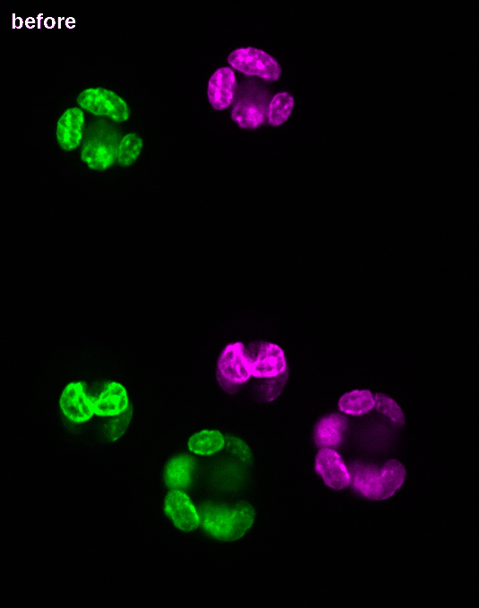
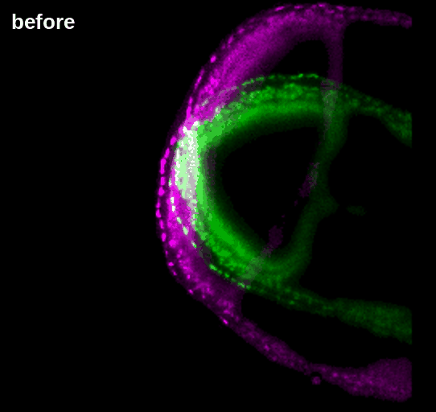

# Registration with OME-Zarr

**Out-of-core registration, OME-Zarr in and out.**

| In this tutorial: two rounds of an organoid | At scale: two time points of a mouse embryo |
|---|---|
|  |  |

Registering two images usually ends with a resampled copy of your data and a transform that only one tool can read.

Here the result stays in OME-Zarr: the two images and the transformation between them, in one file, applied when a
reader needs it, with no resampled copy of the data.

## Objectives

By the end of this tutorial, you will have:

1. **read** OME-Zarr images from a public archive, loading only what you ask for;
2. **registered** them with one command, on a laptop, without a GPU, with the transformation in OME-Zarr;
3. **written** the images and that RFC-5 transformation in one OME-Zarr 0.6 file, with ngff-zarr, and read it back;
4. **applied** it lazily to the image and to its labels, without writing a resampled copy.

It takes about 30 minutes, of which 3 of computing.

## The four steps

| Step | What it does | With | You get |
|---|---|---|---|
| **[1. Read](steps/1-read.ipynb)** | Opens two rounds of an organoid, straight from Zenodo | ngff-zarr | `R0.ome.zarr`, `R1.ome.zarr` |
| **[2. Register](steps/2-register.ipynb)** | Aligns R1 onto R0, with one command | IMPACT-Reg | `Transform.ome.zarr`: an RFC-5 `affine`, twelve numbers |
| **[3. Write, and read back](steps/3-write.ipynb)** | Puts both images and the transformation in one scene, and checks what a reader finds | ngff-zarr | `pair.ozx` |
| **[4. Apply](steps/4-apply.ipynb)** | Applies it to the image and the nuclei, lazily | ngff-zarr | nuclei overlap: 0 → 0.92 |

One notebook per step, each with its outputs saved: you can read them here before running anything.

Step 2 is the only one that uses KonfAI. With a registration tool of your own, replace that step: steps 3 and 4 only need
an RFC-5 transformation in OME-Zarr, an `affine` or a `displacements` field.

## Install

Python 3.11 or newer. No GPU needed. Please install before the session: torch and the registration engines are large
downloads.

```bash
git clone https://github.com/fideus-labs/ome-zarr-registration-tutorial
cd ome-zarr-registration-tutorial
python -m venv .venv && source .venv/bin/activate
pip install -r requirements.txt
jupyter lab steps/1-read.ipynb
```

## The data

**[Zenodo 13982701](https://zenodo.org/records/13982701)**: one organoid imaged in two multiplexed rounds, DAPI, 50 × 680 × 535
voxels of 0.6 × 0.217 × 0.217 µm, with its organoid and nuclei labels. A Fractal HCS plate of 38 MB, by Nicole Repina
(FMI), CC-BY 4.0. Nothing to download by hand.

## Going further

**[Going further](going-further.md)**: your own pair, 2-D images, and the same commands on larger images:

- **[`demo/`](demo/README.md):** a mouse embryo, two time points read from a 9.3 TB public series;
- **[Two mouse brains](media/videos/two-mouse-brains.mp4)** (video): up to 1.2 billion voxels on a laptop GPU.

## At the OME-Zarr Hackathon

This tutorial belongs to the *Image Registration Workflows with OME-Zarr* topic of the OME-Zarr Hackathon 2026 in Zürich
(2 to 6 November), led by Valentin Boussot (KonfAI, IMPACT-Reg) and Matt McCormick (Fideus Labs, ngff-zarr). Bring two
images that should line up, or a reader or viewer to test against the result.

## License

The code and text are under the [MIT license](LICENSE). The data is CC-BY 4.0, as stated on its Zenodo record.
