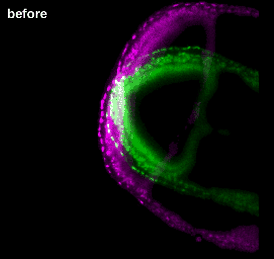
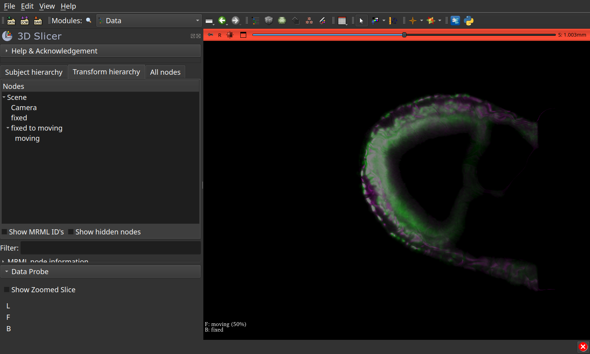

# Demo: a mouse embryo at scale

Two time points, 8 h 20 min apart, of one mouse embryo filmed in light-sheet
([McDole et al., Cell 2018](https://doi.org/10.1016/j.cell.2018.09.031)). The series is 9.3 TB on the
[IDR](https://idr.openmicroscopy.org/); this reads two time points of one channel, at one level, and nothing else.

```bash
bash demo/run.sh                            # level 3 (69 million voxels) of time points 150 and 250, on GPU 0
SLICER=/path/to/Slicer bash demo/run.sh     # the same, then the scene opened in 3D Slicer
```

| Step | Result, on a laptop GPU |
|---|---|
| Read | about 12 s per time point |
| Register (`ConvexAdam_Composite`, `--fields-only`) | 2 min 20 s, correlation on the tissue 0.30 -> 0.70; the field alone is written, no resampled image |
| Write | `pair.ozx`, 717 MB: the two images as they came, and the field, 689 MB, against 1.6 GB for `Transform.h5` |
| Apply | one plane computed, from `pair.ozx`, in about a second |
| Look | `pair.ome.zarr` in 3D Slicer, in about 5 s: the two time points, and the field as a grid transform, applied as stored |

The whole run takes about 3 minutes and 12 GB of memory. The score depends on the memory: under 22 GB, the coarse pass
holds fewer voxels and the correlation falls to 0.59.



## In 3D Slicer

Install the [SlicerOMEZarr](https://github.com/fideus-labs/SlicerOMEZarr) extension and drag
`output/embryo/pair.ome.zarr` onto Slicer, or open it from the OME-Zarr module. You get three nodes: `fixed`, the
displacement field as the transform node `fixed to moving`, and `moving` under it, shown half transparent over `fixed`.
The field is applied as stored and never inverted.


