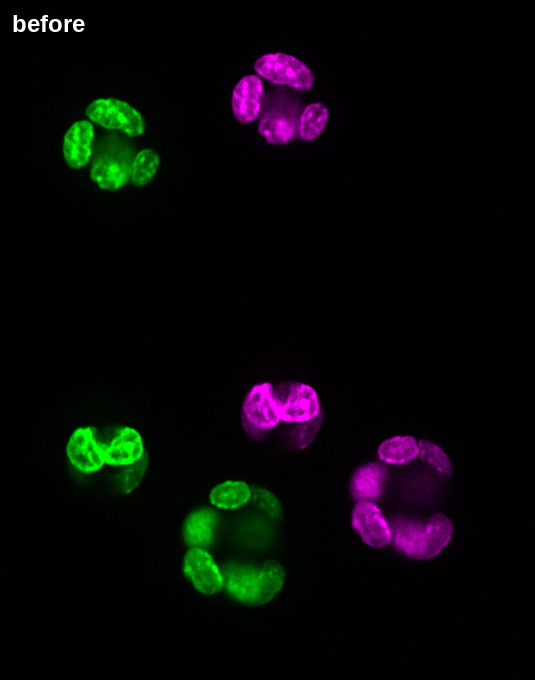

# Step 1. Read

**Goal:** open two OME-Zarr images from a public archive, and read only what you need.

## Run it

```bash
python steps/read.py
```

## What you should see

```text
R0: 50 x 680 x 535 voxels of 0.6 x 0.217 x 0.217 micrometers, 5 levels
R1: 50 x 680 x 535 voxels of 0.6 x 0.217 x 0.217 micrometers, 5 levels
Before registration: output/before.png
Local stores: output/R0.ome.zarr, output/R1.ome.zarr
```

Green is round R0, magenta is round R1. The same organoid has moved between the two rounds, and the two colours do not
overlap at all:



## What just happened

- **Opening an image reads almost nothing.** The images sit in a 38 MB zip on Zenodo, and ngff-zarr opened them where
  they are, from their metadata.
- **An image is a pyramid with a geometry.** Each of the 5 levels knows its voxel size and its unit. The registration
  will use them: nothing here is in pixels.
- **Reading is lazy.** `image.data` is a dask array. Only what you compute is read: here, one plane of one level.

The part that matters in [`read.py`](read.py):

```python
archive = fsspec.filesystem("zip", fo=fsspec.open(ARCHIVE).open())
multiscales = nz.from_ngff_zarr(archive.get_mapper("220605_151046.zarr/C/02/0"))
plane = multiscales.images[2].data[0, 25]  # level 2, channel 0, plane 25: not read yet
```

The script then keeps a local copy of both images and of their nuclei, because the registration of step 2 reads local
stores.

**Next: [Step 2. Register](2-register.md)**
