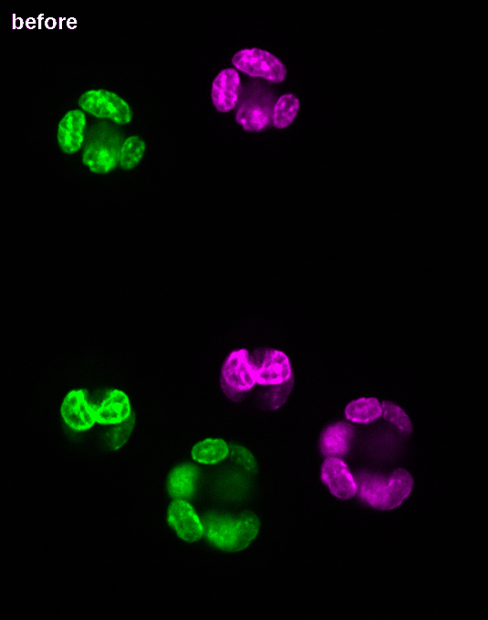

# Step 4. Apply

**Goal:** use the registration from the scene, without writing a resampled copy.

## Run it

```bash
python steps/apply.py
```

## What you should see

```text
The scene holds an RFC-5 'affine' from fixed to moving
Correlation with the fixed image, on one plane: -0.06 -> 0.89
After registration: output/after.png
Overlap of the nuclei (Dice): 0.00 -> 0.91
```

Where the two rounds agree, green and magenta turn white:



## What just happened

- **`pair.ozx` is enough for the image.** The two images and the transformation travel together. The nuclei come from
  their own stores, the ones step 1 wrote.
- **The result is lazy.** `resample` describes the moved image block by block. Computing one plane reads only the part
  of the moving image it needs.
- **The same transformation carries everything else** on the moving side: here the nuclei, with an interpolation that
  keeps their labels.

The part that matters in [`apply.py`](apply.py):

```python
scene = nz.NgffScene.from_ome_zarr("output/pair.ozx")
transformation = scene.coordinateTransformations[0]
fixed, moving = scene.images["fixed"].images[0], scene.images["moving"].images[0]

moved = nz.resample(transformation, fixed, moving)  # lazy
plane = moved.data[25].compute()                    # reads what this plane needs
nuclei = nz.resample(transformation, fixed, labels, interpolator="label_image")
```

A deformable scene also passes its field: `fields={path: nz.from_ome_zarr(f"{scene}/{path}")}`. `apply.py` does both.

## Map points

A landmark goes through the same transformation, without any image. Points are in the input's coordinates, in
micrometers and in the order z, y, x, not in voxels:

```bash
echo '[[15.0, 73.0, 58.0]]' > output/points.json
ngff-zarr transform-points output/pair.ozx output/points.json
```

```text
{"dims": ["z", "y", "x"], "points": [[16.13, 63.21, 94.36]]}
```

## You are done

You started from two images in a public archive, and you have one file holding them and their registration, which any
OME-Zarr 0.6 reader can apply. **[Going further](../going-further.md)**: larger images, your own pair, 2-D.
