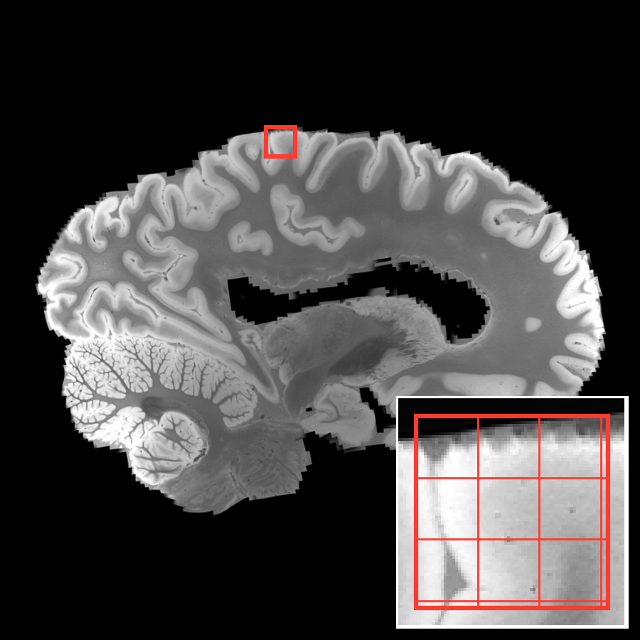
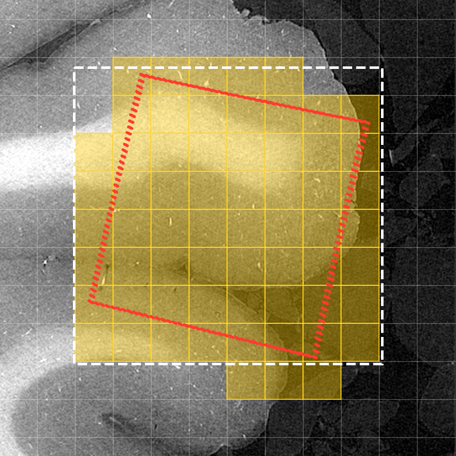

# A small cube from a huge scan

A 7 T MRI of a human hemisphere (fixed, 6 GB) and the same hemisphere scanned at a synchrotron (moving, 976 GB at
20 µm). From the LINC project, subject Hb1, [DANDI 001278](https://dandiarchive.org/dandiset/001278), CC-BY 4.0, read
as OME-Zarr from DANDI's public S3.

The question is the resample, not the registration: pick a small cube in the MRI and fill it with the scan at full
resolution, through an affine and a B-spline, without reading the whole scan. ngff-zarr first bounds where each output
block lands in the scan, then reads only the chunks inside that bound.

**[resample.ipynb](resample.ipynb)** runs it in about two and a half minutes, reading the data where it is:

| | |
|---|---|
| Output | an 8 mm cube of cortex, 399³ voxels at 20 µm |
| Read | 466 of 1.9 million chunks: 0.24 GB of the 976 GB scan |
| Time | 18 s for the cube |

| The cube, chosen in the MRI | Where it lands in the scan |
|---|---|
|  |  |

On the right: where the cube lands in the scan (red), the bound ngff-zarr computes before reading (dashed), and the
chunks it reads (yellow). The rest of the scan is never read.

```bash
pip install matplotlib   # on top of the tutorial's requirements
jupyter lab use-cases/human-hemisphere/resample.ipynb
```

Or in one command with [`steps/resample.py`](../../steps/resample.py). The fixed image is a cube cut out of the MRI,
and `--spacing` fills it at the scan's 20 µm:

```bash
cd use-cases/human-hemisphere
python crop_mri.py 36.0 46.4 92.4 8 output/mri_cube.ome.zarr    # centre (z, y, x) and size, in mm
python ../../steps/resample.py output/mri_cube.ome.zarr s3://dandiarchive/zarr/6f11427f-ef86-42b8-9800-d3e09265c965 \
    bspline.h5 sform.h5 -o output/cube.ome.zarr --spacing 0.02007 \
    --storage-options '{"skip_signature": true, "region": "us-east-2"}'
```

| File | What it is |
|---|---|
| [`bspline.h5`](bspline.h5), [`sform.h5`](sform.h5) | the transformation, two ITK files applied in this order: a cubic B-spline (19 kB), then LINC's affine from the MRI into the scan's frame |
| [`hemisphere.py`](hemisphere.py) | both images as lazy NgffImages in millimeters, the affine, and the notebook's figures |
| [`crop_mri.py`](crop_mri.py) | a cube of the MRI as a small local OME-Zarr: the fixed image of the command |
| [`make_bspline.py`](make_bspline.py) | where the B-spline comes from: IMPACT-Reg's `Elastix_IMPACT_Static` at 1 mm (about 3 min on a CPU), fitted with an ITK `BSplineTransform` (within 0.2 mm, median) |

The two images have inverted contrasts: grey matter is bright in the MRI, white matter in the scan. A correlation says
little here; look at the pictures.
