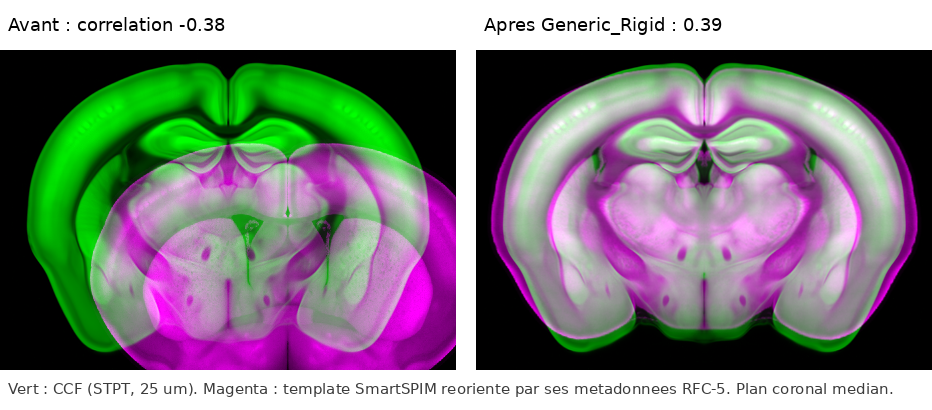
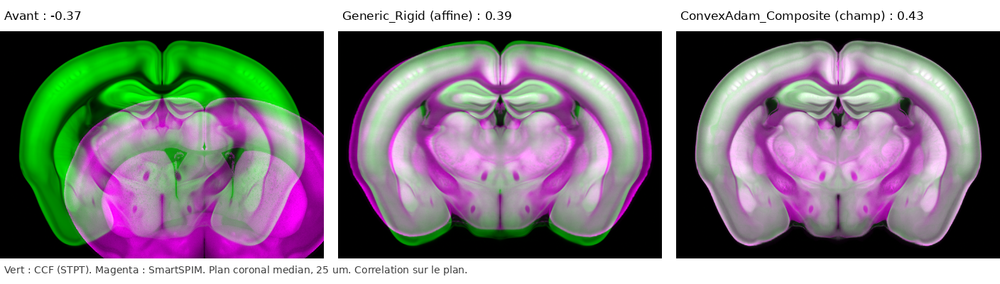

# Mouse-brain templates

A case brought to the OME-Zarr Hackathon 2026 by the Allen Institute: register light-sheet mouse-brain templates onto
the Allen CCF atlas, all read from S3. Run everything from the root of the repository, in the tutorial's environment.
Outputs go to `use-cases/mouse-brain/output/`.

## The data

| Template | Store | Format | Voxel | Levels | Axes |
|---|---|---|---|---|---|
| CCF, STPT 2020 | `s3://allen-atlas-assets/templates/allen-adult-mouse-stpt-template/2020/template.ome.zarr` | OME-Zarr 0.6 | 10 µm, mm | 10, 25 µm | z A→P, y D→V, x L→R |
| SmartSPIM LCA 2024-05 | `s3://allen-atlas-assets/templates/allen-adult-mouse-spim-lca-template/2024-05/template.ome.zarr` | OME-Zarr 0.6 | 10 µm, mm | 10 to 100 µm | z R→L, y A→P, x D→V |
| ExaSPIM CCFv4 2026-09 | `s3://aind-scratch-data/exaspim-ccfv4-template/20260930-2055/template.ome.zarr` | OME-Zarr 0.5 | 40 × 30 × 30 µm | 4 | not declared; a whole head |

- All three read anonymously. Use the `s3://` form with `storage_options={"skip_signature": True, "region":
  "us-west-2"}`: it opens in 3 s. The `https://…s3.amazonaws.com` form makes obstore look for EC2 credentials and hang.
- The two Allen stores declare RFC-4 orientations on their axes. Their axes differ by a permutation and a flip.

## 1. Read and reorient

```bash
python use-cases/mouse-brain/read_templates.py      # about 1 GB over S3, ten minutes
python use-cases/mouse-brain/reorient_exaspim.py    # the ExaSPIM, by hand: it declares no orientation
```

`read_templates.py` reads one level of each template (25 µm for CCF and SmartSPIM, 60 µm for ExaSPIM) and puts
SmartSPIM on the CCF's axes, using its declared orientations: `transpose [1, 2, 0]`, then flip x. No interpolation.
The ExaSPIM declares nothing, so `reorient_exaspim.py` does the same from its middle planes (nose along +x, dorsal
along −z). Its left-right handedness is assumed.

## 2. Register SmartSPIM onto the CCF

```bash
impact-reg-konfai register Generic_Rigid -f use-cases/mouse-brain/output/ccf.ome.zarr -m use-cases/mouse-brain/output/smartspim.ome.zarr \
    -o use-cases/mouse-brain/output/rigid --cpu 8 --fields-only \
    --set Predictor.outputs_dataset.DisplacementField.OutputDataset.dataset_filename=Transform:omezarr
# the same with FireANTs_SyN --gpu 0 -o use-cases/mouse-brain/output/fireants, and with ConvexAdam_Composite
```

## 3 and 4. Write, apply, look

```bash
python steps/write.py use-cases/mouse-brain/output/ccf.ome.zarr use-cases/mouse-brain/output/smartspim.ome.zarr \
    use-cases/mouse-brain/output/fireants/P000/Transform.ome.zarr use-cases/mouse-brain/output/fireants.ozx --overwrite
python steps/apply.py use-cases/mouse-brain/output/fireants.ozx
python use-cases/mouse-brain/pictures.py use-cases/mouse-brain/output/fireants.ozx    # overlays and checkerboards
python use-cases/mouse-brain/moved_10um.py                                            # the field applied at 10 µm
```

Correlation with the CCF on the three middle planes (before: coronal −0.38, horizontal 0.01):

| Preset | Time | Coronal | Horizontal | Sagittal | Notes |
|---|---|---|---|---|---|
| `Generic_Rigid` | 48 s, CPU | 0.39 | 0.15 | 0.24 | an affine, about 1.5 mm of translation per axis. A rigid cannot fix the size difference |
| `ConvexAdam_Composite` | 4 min 27 s, GPU | 0.43 | 0.12 | 0.20 | a 718 MB field. The cortex follows the CCF; olfactory bulbs and cerebellum lag behind |
| `FireANTs_SyN` | 7 min 07 s, GPU | 0.44 | 0.36 | 0.49 | a 724 MB field. Its affine stage takes the size difference: the best on every plane |

STPT and light-sheet contrasts differ inside the brain, so even a perfect alignment scores well below 1. Trust the
checkerboards more than the numbers.

**At 10 µm.** The registration ran at 25 µm, but the transformations are in millimeters, so they apply at any level.
`moved_10um.py` applies the FireANTs field to the 10 µm level of both S3 stores: 1320 × 800 × 1140 voxels, 2.2 GB, in
90 s.

## In 3D Slicer and napari

```bash
Slicer --python-script use-cases/mouse-brain/slicer_before_after.py   # before and after, the FireANTs transformation
Slicer --python-script use-cases/mouse-brain/slicer_view.py           # the stores, the moved copies, the transformations
python use-cases/mouse-brain/napari_scene.py use-cases/mouse-brain/output/rigid.ome.zarr use-cases/mouse-brain/output/napari_rigid.png --keep
```

With SlicerOMEZarr, `rigid.ome.zarr` and `fireants.ome.zarr` open as scenes: the moving image under the transformation,
a linear transform for the affine, a grid transform for the field. `napari_scene.py` shows a scene in napari, resampled
lazily by ngff-zarr.

ngff-zarr's RFC-4 helper only knows the six human orientations, and `dorsal-to-ventral` is not one of them. So
SlicerOMEZarr falls back to an identity direction for these stores. That is also the frame KonfAI registered in, so
the transformations apply as they are, but Slicer's A/P/S/I labels do not match the mouse's axes.

## Figures

| | |
|---|---|
|  |  |

- `rigid_planes.png`, `convexadam_planes.png`, `fireants_planes.png`: overlays and checkerboards, one per preset.
- `fireants_10um_coronal.png`: the FireANTs field applied at 10 µm.
- `slicer_before_red.png`, `slicer_after_*.png`: 3D Slicer, before and after.
- `napari_rigid.png`, `napari_fireants.png`: the two scenes in napari.
- `exaspim_axes_mid_*.png`, `exaspim_rigid_planes.png`: the ExaSPIM on the CCF's axes, and its rigid registration.

## Still open

The ExaSPIM is a whole head with no declared orientation. Reoriented by hand, its rigid registration runs; it needs a
brain mask before a deformable one means anything.
