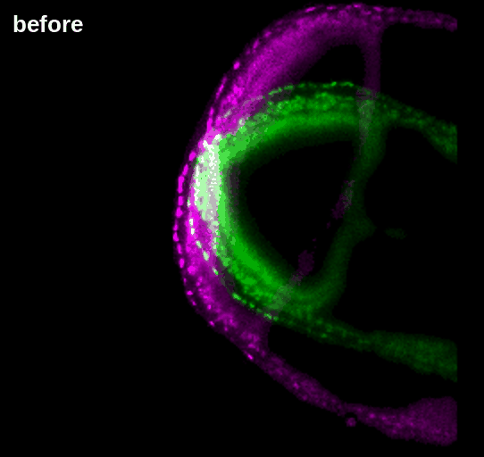
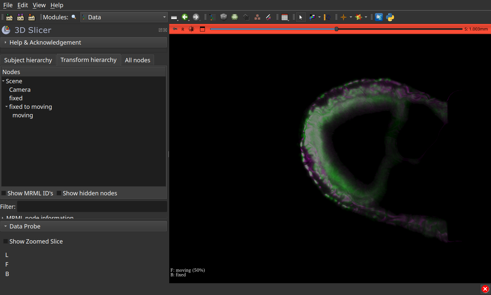

# A mouse embryo, from a 9.3 TB series

Two time points of one mouse embryo, 8 h 20 min apart, filmed in light-sheet
([McDole et al., Cell 2018](https://doi.org/10.1016/j.cell.2018.09.031)). The whole series is 9.3 TB on the
[IDR](https://idr.openmicroscopy.org/). The script reads only two time points, one channel, at one level.

```bash
bash use-cases/mouse-embryo/run.sh                          # level 3 of time points 150 and 250, on GPU 0
SLICER=/path/to/Slicer bash use-cases/mouse-embryo/run.sh   # then opens the scene in 3D Slicer
```

On a laptop GPU, about 3 minutes and 12 GB of memory:

| Step | Result |
|---|---|
| Read | about 12 s per time point, 69 million voxels each |
| Register | `ConvexAdam_Composite`, 2 min 20 s; correlation on the tissue 0.30 → 0.70 |
| Write | `pair.ozx`, 717 MB: the two images and the field (689 MB; as `Transform.h5`, the same field is 1.6 GB) |
| Apply | one plane, from `pair.ozx`, in about a second |
| Look | the scene in 3D Slicer, in about 5 s |

With less than 22 GB of memory, the coarse pass uses fewer voxels and the correlation drops to 0.59.



## In 3D Slicer

With the [SlicerOMEZarr](https://github.com/fideus-labs/SlicerOMEZarr) extension, drag
`use-cases/mouse-embryo/output/pair.ome.zarr` onto Slicer. You get `fixed`, the field as the transform node
`fixed to moving`, and `moving` under it, half transparent over `fixed`. The field is applied as stored, never inverted.


